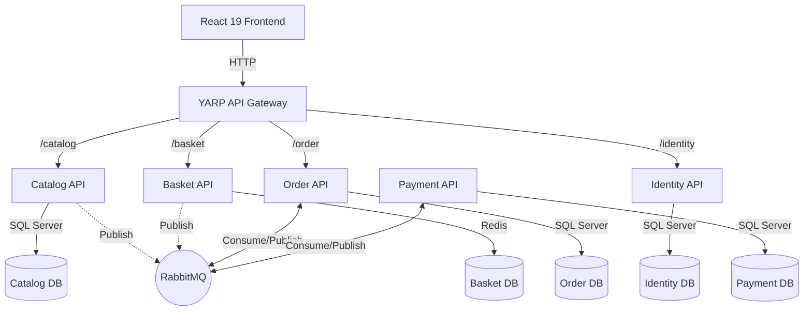

# 🛒 FStore — Cloud-Native E-Commerce Platform

A production-grade, event-driven microservices e-commerce platform built with **.NET 10**, **React 19**, **Docker**, and **RabbitMQ**. 

FStore demonstrates enterprise-level architectural patterns including Clean Architecture, CQRS, Event-Driven Sagas, and Role-Based Access Control (RBAC).

## 🏗 Architecture

FStore is built using a **Choreography-based Saga** pattern. Services are completely decoupled, own their databases, and communicate asynchronously via a message bus to maintain eventual consistency.



### Backend Services

* **API Gateway (YARP):** Single entry point, routing, JWT validation, and CORS handling.
* **Identity Service:** Handles user registration, login, and issues JWT tokens with Role-Based Access Control.
* **Catalog Service:** Manages products and categories, supporting pagination, filtering, and search.
* **Basket Service:** Manages user shopping carts with high-speed caching (Redis).
* **Order Service:** Orchestrates the checkout Saga, manages order state machines, and handles compensations.
* **Payment Service:** Mocks a payment gateway, processing transactions and handling declines via the event bus.

### Core Patterns & Technologies

*   **Architecture:** Clean Architecture, CQRS (MediatR), Vertical Slice (Feature folders).
*   **Messaging:** RabbitMQ with MassTransit (Choreography Saga, Compensating Transactions).
*   **Testing:** xUnit, Testcontainers (real DBs in Docker for integration tests), Respawn, NSubstitute.
*   **DevOps:** Fully containerized (Docker Compose), CI/CD via GitHub Actions.

## 🔄 The Event-Driven Checkout Flow

When a user places an order, the system executes a distributed transaction across multiple microservices:

1. **Basket API** clears the cart and publishes a `BasketCheckoutEvent`.
2. **Order API** consumes the event, creates a `Pending` Order, and publishes `OrderCreatedEvent`.
3. **Order API** (internally) reserves stock and publishes `OrderConfirmedEvent`.
4. **Payment API** consumes `OrderConfirmedEvent`, processes the mock payment, and publishes `PaymentProcessedEvent`.
5. **Order API** consumes the payment result:
    *   If successful, the Order status becomes `Confirmed`.
    *   If declined, the Order is `Cancelled`, and compensating events are fired to restore the user's cart.

## 🚀 Quick Start (Run Locally)

You only need **Docker Desktop** installed.

```bash
git clone https://github.com/finnldecv/FStore.git
cd FStore
docker compose up -d --build
```

### Accessing the Application

*   **Storefront:** [http://localhost:5173](http://localhost:5173)
*   **API Gateway (Swagger):** [http://localhost:5000/swagger](http://localhost:5000/swagger)
*   **RabbitMQ Management:** [http://localhost:15672](http://localhost:15672) (guest / guest)

### Default Admin Credentials

To test the admin dashboard and product management:

*   **Email:** `admin@fstore.com`
*   **Password:** `Admin123!`

## 🧪 Testing

The solution features comprehensive unit and integration test suites. Integration tests use **Testcontainers** to spin up real SQL Server and Redis instances during the test run.

```bash
# Run all backend tests
dotnet test FStore.sln

# Run frontend tests
cd src/Apps/FStore.Web
npm run test
```

## 🛠️ Technical Decisions

*   **Why YARP over Ocelot?** YARP is Microsoft's modern, high-performance reverse proxy built on .NET, offering better performance and easier configuration than the legacy Ocelot.
*   **Why CQRS and MediatR?** To keep read and write logic strictly separated, ensuring that complex business rules don't bleed into query logic, and allowing for a clean vertical slice architecture.
*   **Why a Choreography Saga?** To avoid a single point of failure (Orchestrator). Each service reacts to events independently, ensuring the system remains highly available and loosely coupled.

---

### Next Steps to Make it Legendary:
1. **Screenshots:** Take screenshots of your React UI (Storefront, Cart, Admin Dashboard) and save them in a `docs/images` folder. Add them to the README like this:
   ``
2. **Add a Demo Link:** Once you deploy to your VPS, put the live URL at the very top next to the project name.
3. **Seed the Data:** Make sure `docker compose up -d --build` on a fresh machine automatically seeds the database (as instructed in the previous step) so the reviewer doesn't see a blank storefront when they test it.